# Survey Module

## 1. General Description
The survey collects the user data after the first application running, and it consists of 4 screens (fragments).
Also, the 2nd and 3rd screens can be used again in the "Edit Mode" (isEditMode), when the user changes his data.

| Screen | Class                 | ViewBinding | Purpose                                                                   |
|--------|-----------------------|---|---------------------------------------------------------------------------|
| 1      | `SurveyPage1Fragment` | `SurveyPage1Binding` | Welcoming, continue next button                                           |
| 2      | `SurveyPage2Fragment` | `SurveyPage2Binding` | Name, Date of Birth, Gendre                                               |
| 3      | `SurveyPage3Fragment` | `SurveyPage3Binding` | Trainings goals (6 cards + own goal)                                      |
| 4      | `SurveyPage4Fragment` | `SurveyPage4Binding` | Finalising: saving the profile to DB and redirect to home page (calendar) |

Packet: `com.example.fitnesscalendar.logic.survey`

---

## 2. Files and connections
Key idea: **all screens utilise one common `SurveyViewModel`**, which is linked to Activity (`new ViewModelProvider(requireActivity())`).
While the user switches the screens, the data is stored there, only after pressing the button in the end or **Save** in edit mode the new data is written in the DB.

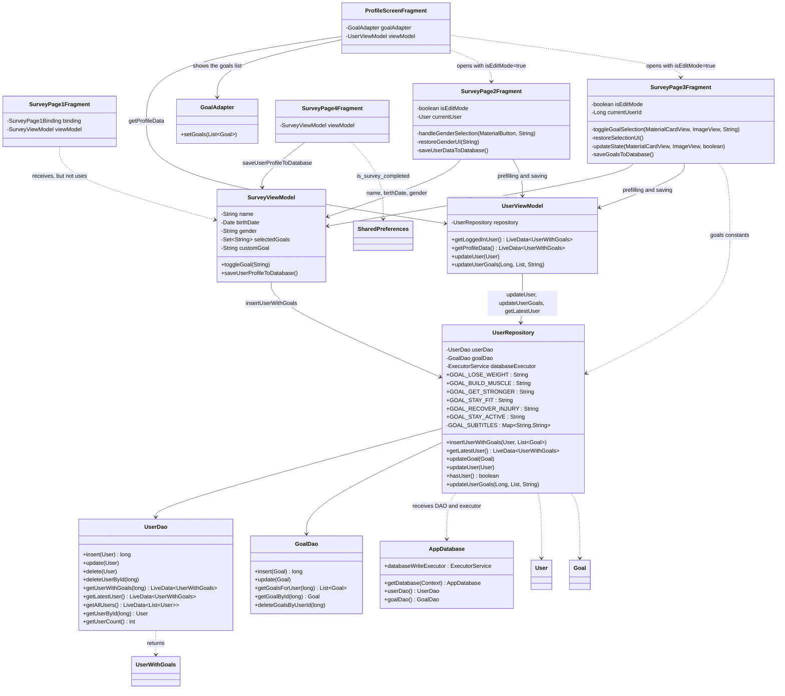

## 3. Navigation between the screens
The transitions are described in navigation graph through actions:

| From where | To where         | Action                                   |
|------------|------------------|------------------------------------------|
| Page 1     | Page 2           | `action_SurveyPage1_to_SurveyPage2`      |
| Page 2     | Page 3           | `action_SurveyPage2_to_SurveyPage3`      |
| Page 3     | Page 4           | `action_SurveyPage3_to_SurveyPage4`      |
| Page 4     | CalendarHomePage | `action_SurveyPage4_to_CalendarHomePage`  (с `popUpTo`)|

The button Back calls navigateUp() on the 2 and 3 screens. The button Back in absent on the 4th screen.

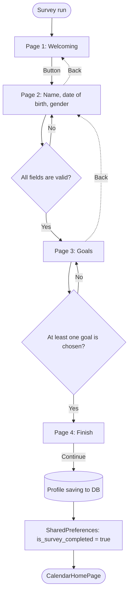
For transition to `CalendarHomePage` is used `setPopUpTo(R.id.SurveyPage1, true)`. This removes all survey screens (including the first) from the stack.

---

## 3.1. Where to access edit mode? (`ProfileScreenFragment`)

The answer on the question «Where to access `isEditMode`»: from the profile screen, `ProfileScreenFragment` (package `com.example.fitnesscalendar.logic.profile`). Exactly this file puts `isEditMode = true` in `Bundle` and passes it as arguments to the `SurveyPage2` fragment during navigation which is this - `getArguments().getBoolean("isEditMode", false)`, which read 2 and 3 screens.

**Profile screen demonstrates:**

- username (`binding.userNameTitle`) and the list of goals — through `RecyclerView` with `LinearLayoutManager` and with adapter `GoalAdapter` (`setGoals(List<Goal>)`). It is a separate adapter, not linked with `Adapter` for `GridView` of the calendar, it has another base (`RecyclerView.Adapter`, not `BaseAdapter`), but the role is the same - convert a list of data into rows on the screen.
- data is loaded via `viewModel.getProfileData().observe(...)` — the same `UserViewModel`, that is used by 2 and 3 screens for edit mode 

**Two separate entrance for editing:**

| Screen element           | Opens                 | Action | With                |
|--------------------------|-----------------------| --- |---------------------|
| `binding.userData`       | `SurveyPage2Fragment` | `action_ProfileFragment_to_SurveyPage2` | `isEditMode = true` |
| `binding.editGoalButton` | `SurveyPage3Fragment` | `action_ProfileFragment_to_SurveyPage3` | `isEditMode = true` |

That means that personal data (name, date of birth, gender) and goals are edited separately. Each screen of the survey is opened - after saving the user redirects back to the profile via `navigateUp()` (see part 5).

**Other navigation options from this screen** (they are not linked to the survey, but visible in the same file): `allExercisesRow` → `action_NavigationProfile_to_ExercisesList`, `allWorkoutsRow` → `action_NavigationProfile_to_WorkoutsList`.

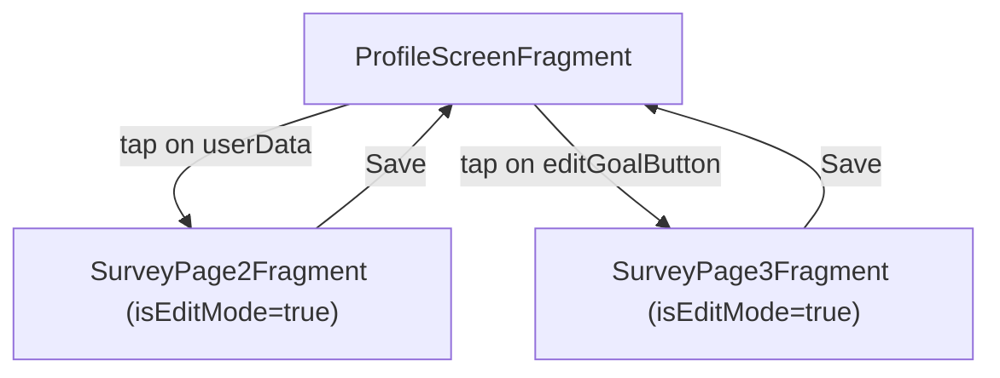

## 4. Two modes: onboarding and edit
The screens 2 and 3 read argument `isEditMode` from `getArguments()` (false by default)

|                         | Onboarding (`isEditMode = false`)                     | Edit (`isEditMode = true`)                                                      |
|-------------------------|-------------------------------------------------------|---------------------------------------------------------------------------------|
| Title                   | XML                                                   | "Edit my data" (screen 2), "Edit goals" (screen 3)                              |
| Button `continueButton` | "Continue" leads to the next screen                   | "Save", saves to DB                                                             |
| Button Back             | is visible                                            | `INVISIBLE`                                                                     |
| Background              | initial XML                                           | other colour (`#FFFAFA` on screen 2, `home_page_background_colour` on screen 3) |
| The values source       | from `SurveyViewModel` (if user already entered smth) | from DB through `UserViewModel.getLoggedInUser()`                               |
| After tapping button    | transition to the next screen                         | writing to DB, clearing `SurveyViewModel`, Toast, `navigateUp()`                |

---

## 5. Survey screens
### Screen 1: Welcoming

**Files:** `SurveyPage1Fragment.java`, `survey_page_1.xml`

The only action: button `binding.button` which redirects to screen 2 `action_SurveyPage1_to_SurveyPage2`. `SurveyViewModel` can be received but not used. A common ViewModel is created in Activity before the second screen.

---

### Screen 2: Personal data
**Files:** `SurveyPage2Fragment.java`, `survey_page_2.xml`
**The requested data:**

| Field         | View | Validation | Where stored |
|---------------|---|---|--------------|
| Name          | `userInputName` (EditText) | the field cannot be empty `trim()`, otherwise `setError("Please enter your name")` | `surveyViewModel.setName()` upon clicking Continue |
| Date of Birth | `userInputBirthDate` (upon clicking `DatePickerDialog` is opened) | must be selected, otherwise `setError("Please select your birth date")` | `surveyViewModel.setBirthDate()` immediately after selecting the date | 
| Gender        | `buttonMale`, `buttonFemale`, `buttonNoAnswer` (MaterialButton) | must be selected, otherwise Toast "Please select a gender" | `surveyViewModel.setGender()` just after clicking |

The values of the gender: `"Male"`, `"Female"`, `"Prefer not to say"`.

**Highlighting of the selected gender** (`handleGenderSelection(MaterialButton selectedButton, String genderValue)`: the selected button gets an orange border, other buttons get a gray border.

**DatePicker:** the starting date is taken from the ViewModel (if it was already taken), otherwise today's date. Maximum date is today (`setMaxDate(System.currentTimeMillis())`). Display format: `dd/MM/yyyy`.

**State Restoration / Pre-filling:**

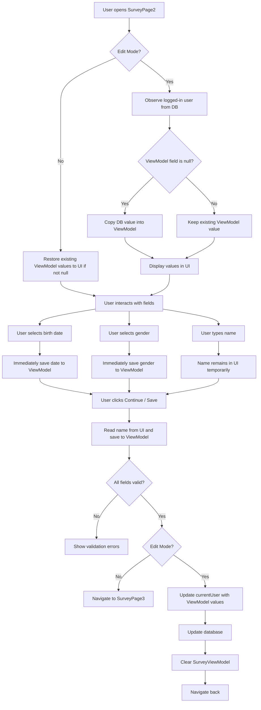

**Prefilling gender:** `restoreGenderUI(String gender)` is a method that passes the stored gender value in SurveyViewModel to `handleGenderSelection` to highlight the selected button. 
Is useful in the cases when the user returns to the 2 screen, to restore selected gender.

**Tapping Continue / Save:**

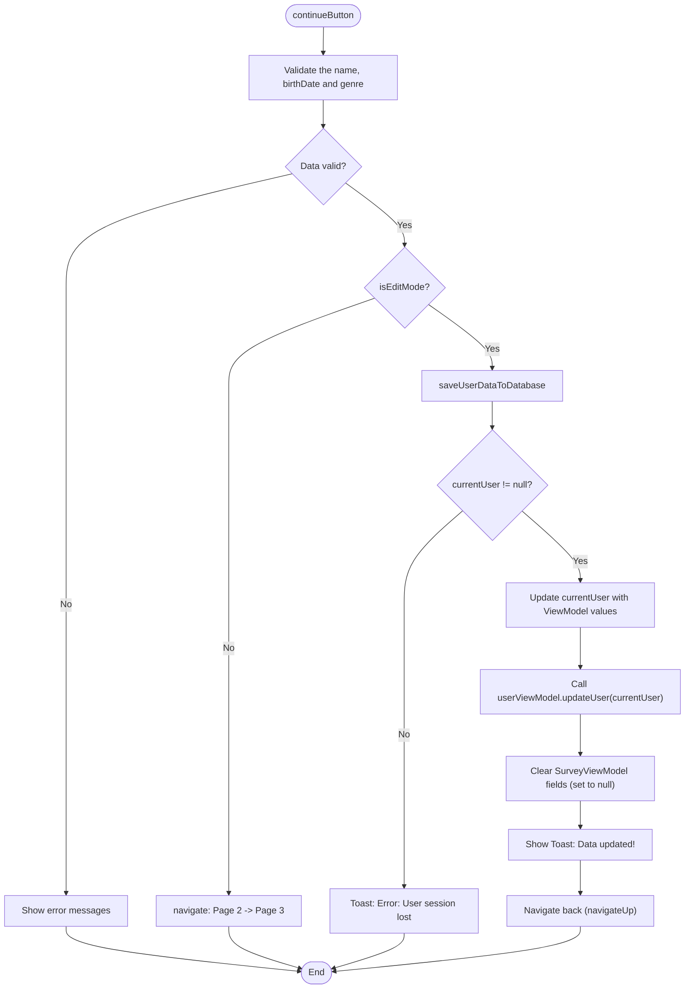

---

### Screen 3: Goals
**Files:** `SurveyPage3Fragment.java`, `survey_page_3.xml`

**The screen task:** the user can select multiple cards and type his/her own goal. At leat one card must be select for passing it to the prompt to Gemini.

| Card         | Indicator | Constant                                            |
|--------------|-----------|-----------------------------------------------------|
| `option1` | `circle1` | `UserRepository.GOAL_LOSE_WEIGHT`                   |
| `option2` | `circle2` | `UserRepository.GOAL_BUILD_MUSCLE`                  |
| `option3` | `circle3` | `UserRepository.GOAL_GET_STRONGER`                  |
| `option4` | `circle4` | `UserRepository.GOAL_STAY_FIT`                      |
| `option5` | `circle5` | `UserRepository.GOAL_RECOVER_INJURY`                |
| `option6` | `circle6` | `UserRepository.GOAL_STAY_ACTIVE`                   |
| `userInputGoal` (EditText) |  | own goal, is stored in `surveyViewModel.customGoal` |

**How the selection works:**

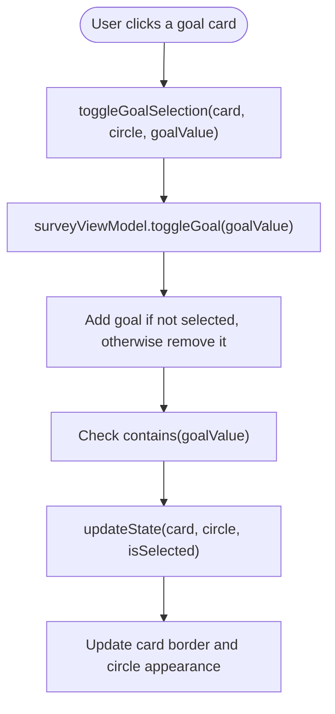

**Own goal:** `TextWatcher` writes text in `surveyViewModel.setCustomGoal()` with every change. The typed text is not lost if the user leaves the screen.

**State restoration:** when creating a screen `restoreSelectionUI()` draws the cards again based on the current state in `selectedGoals` in ViewModel.

**Tapping Continue / Save:**

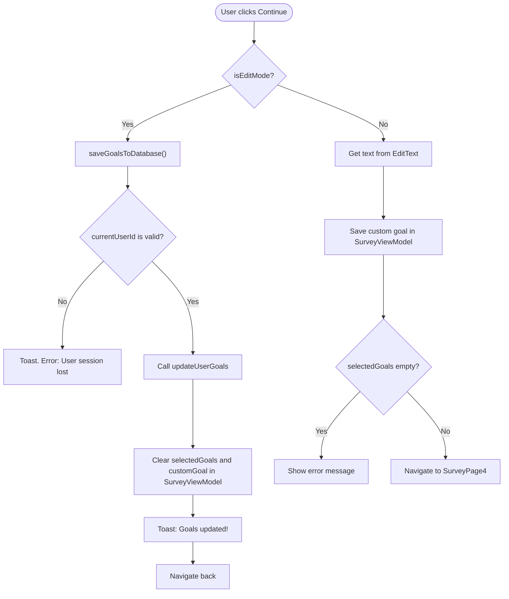

---

### Screen 4: Finalising
**Files:** `SurveyPage4Fragment.java`, `survey_page_4.xml`

Tapping `continueButton`:

1. `viewModel.saveUserProfileToDatabase()`: saves all answers to the DB that were collected on 2 and 3 screens.
2. `SharedPreferences("app_prefs")`: `is_survey_completed = true`. The flag determines that the survey is finished
3. Toast "Profile Saved Successfully!".
4. Transition to `CalendarHomePage` with clearing the survey steak

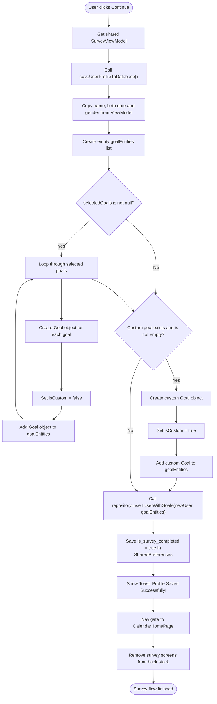

---

## 6. How data flows through SurveyViewModel

The fields `SurveyViewModel` (`name`, `birthDate`, `gender`, `selectedGoals`, `customGoal`) are implemented using Lombok (`@Getter`/`@Setter`), the class — `AndroidViewModel`

| Field           | Writes | When                                     | Reads                                        |
|-----------------|--------|------------------------------------------|----------------------------------------------|
| `name`          | Page 2 | tapping Continue (or prefilling in edit) | Page 2 (edit), `saveUserProfileToDatabase()` |
| `birthDate`     | Page 2 | choosing date in DatePicker              | Page 2 (edit), `saveUserProfileToDatabase()` |
| `gender`        | Page 2 | tapping on gender button                 | Page 2 (edit), `saveUserProfileToDatabase()` |
| `selectedGoals` | Page 3 | tapping on card (`toggleGoal`)           | Page 3 (edit), `saveUserProfileToDatabase()` |
| `customGoal`    | Page 3 | each text changing (`TextWatcher`)       | Page 3 (edit), `saveUserProfileToDatabase()` |

**`saveUserProfileToDatabase()` (is called on screen 4):**

1. The `User` is created with `name`, `birthDate`, `gender`.
2. For each row in `selectedGoals` creates `Goal` with `isCustom = false` flag.
3. If `customGoal` is not empty, adds another one `Goal` with `isCustom = true` flag.
4. Passes `User` and the list `Goal` in `UserRepository.insertUserWithGoals(...)`.

**`UserRepository.insertUserWithGoals(User, List<Goal>)`:**

1. It is executed in the background thread `databaseExecutor`, because the Room prohibits database operations on the main thread.
2. `userDao.insert(user)` returns `newUserId`.
3. For each goal: affixes `userId = newUserId`; if the goal is custom (`!isCustom()`) and its name is in `GOAL_SUBTITLES`, adds subtitle (e.g., for `"Lose Weight"` — *"And see what the discipline can create"*).
4. Retains the goal through `goalDao.insert(goal)`.

Thus, the goal subtitle is generated not within a fragment or a ViewModel, but in the repository, using a static map `GOAL_SUBTITLES`.

---

## 6.1. Storing: entity `User` и `Goal`

Both tables are parts of the common DB `AppDatabase` (Room, `version = 31`), where, in addition to them, 10 other application entities are registered (`CalendarDay`, `Workout`, `Exercise`, etc.). Only two of these (the ones used by the survey) are described here. The whole DB description is here `docs/database.md`.

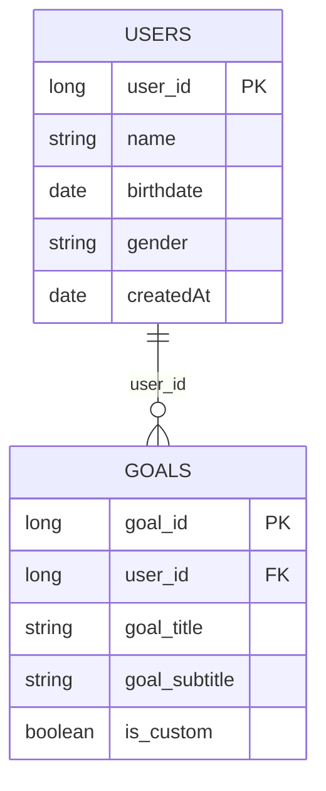

**`User`** (`@Entity(tableName = "users")`): `id` (`user_id`, auto-generation), `name`, `birthDate` (`birth_date`), `gender`, `createdAt` (not related to screen 2, is affixed automatically during new object creation). The class utilises Lombok `@Data` + `@AllArgsConstructor`, getters/setters are generated, not written by hand (`currentUser.setName(...)`, `newUser.setBirthDate(...)` they are called in fragment and viewModel code.

**`Goal`** (`@Entity(tableName = "goals")`, connection 1:М with `User`): `goalId` (PK), `userId` (FK on `users.user_id`, `onDelete = CASCADE` — when a user is deleted, all their goals are automatically deleted), `goalTitle`, `goalSubtitle`, `isCustom`. Index on `user_id` (`@Index("user_id")`) speeds up the `getGoalsForUser`.

**`UserWithGoals`** (is utilised in `getLatestUser()` / `getUserWithGoals()`) — `@Relation`- Room wrapper, which pulls up the user with his list of the goals with one request, exactly its fields `user` and `goals` read survey fragments (`userWithGoals.user`, `userWithGoals.goals`).

**DAO, which the survey utilises:**

| Method | Class | Where called                                                                                           |
|---|---|--------------------------------------------------------------------------------------------------------|
| `insert(User)` | `UserDao` | `insertUserWithGoals` (screen 4, onboarding)                                                           |
| `update(User)` | `UserDao` | `UserRepository.updateUser` (screen 2, edit)                                                           |
| `getLatestUser()` | `UserDao` | `UserViewModel.getLoggedInUser/getProfileData`                                                         |
| `insert(Goal)` | `GoalDao` | `insertUserWithGoals`, `updateUserGoals`                                                               |
| `deleteGoalsByUserId(long)` | `GoalDao` | `updateUserGoals` (screen 3, edit — old goals are removed before adding new ones) |

---

### First survey completion
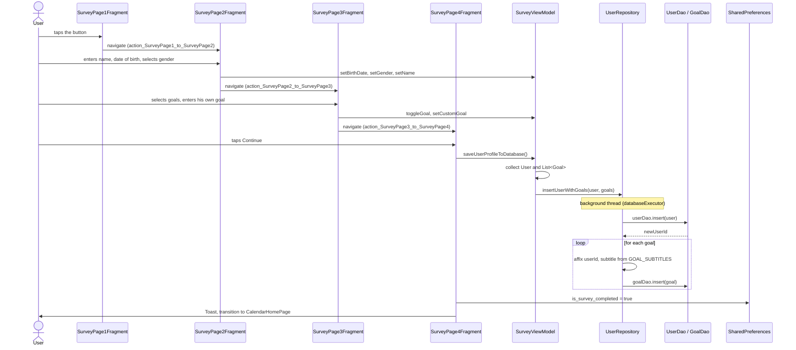

---

### Data editing (screen 2, edit-mode)
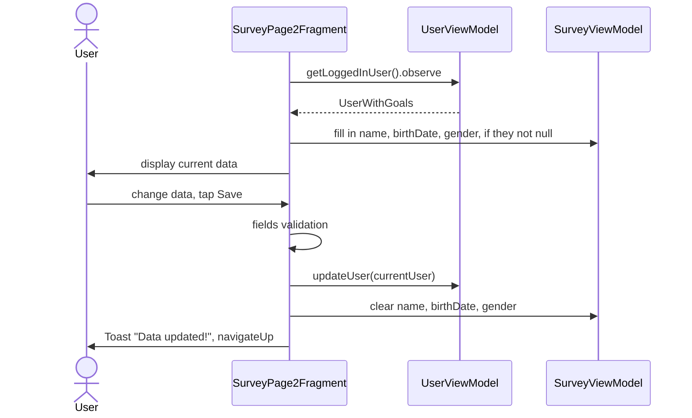

Screen 3 in edit-mode works the same, but instead of`updateUser` it calls `updateUserGoals(currentUserId, selectedTitles, customGoal)`.

---

## 8. Common pattern of all the fragments

- `onCreateView`: a `binding` is created via ViewBinding.
- `onViewCreated`: receiving of mutual ViewModel, buttons binding, state restoration.
- `onDestroyView`: `binding = null`, to avoid keeping references to a View after it has been destroyed (protection against memory leaks).
